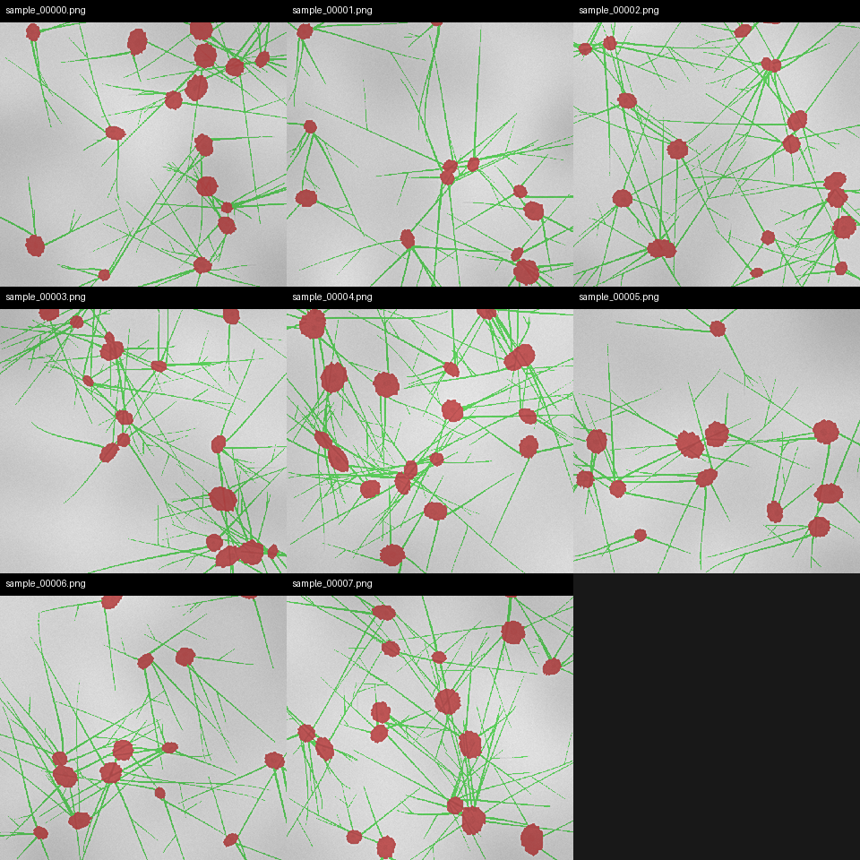
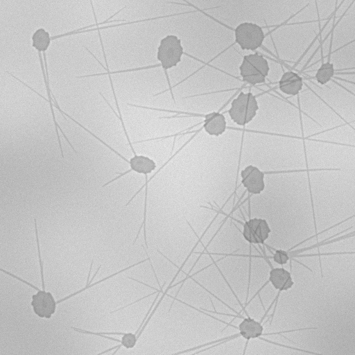
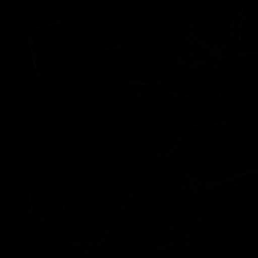
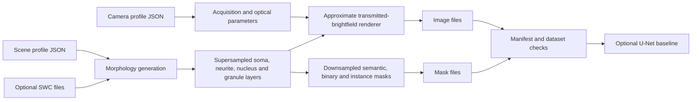

# NAOBF

### NAOMi-inspired synthetic brightfield data for neuronal cell segmentation

NAOBF is a Python prototype that generates small, reproducible sets of synthetic transmitted-brightfield-style images paired with pixel-aligned segmentation labels. It is intended to support early segmentation-pipeline development when annotated microscopy data are scarce. It is **not a calibrated microscope simulator**, and its synthetic-only results are not evidence of performance on real cultures.

> **Status:** prototype v0.1. The repository includes an eight-image demonstration set. A 1,000-simulation target (200 samples in each of five conditions) is a project target only: this version has no five-condition design or verified 1,000-sample run. The current code also has no NEURON/CoreNEURON data integration or neural-activity-to-image coupling.

## At a glance

- Generates procedural soma and branching-neurite geometry, rendered as approximate brightfield images.
- Emits semantic, binary class, union, and cell-instance masks aligned to each synthetic image.
- Supports optional 2-D morphology priors read from SWC files.
- Includes dataset consistency checks, camera-profile checks, labeled-data preparation, reference comparison, and an optional U-Net baseline.
- Runs on CPU; no CUDA, NEURON, or CoreNEURON installation is required for generation or the demo.

<p align="center">
  
</p>

The contact sheet is an audit visualization, not raw microscopy output. Red marks soma labels and green marks neurite labels. Individual generated frames are in [`demo/images`](demo/images/); corresponding semantic and class masks are in [`demo/masks`](demo/masks/).

| Generated brightfield-style image | Semantic mask (0 background, 1 soma, 2 neurite) | Binary masks |
|:--|:--|:--|
|  |  | [Soma](demo/masks/soma/sample_00000.png) · [neurite](demo/masks/neurite/sample_00000.png) · [union](demo/masks/union/sample_00000.png) · [instances](demo/masks/instances/sample_00000.tif) |

## Motivation and scope

Segmenting neuronal cell bodies and thin neurites from label-free images can be difficult because contrast, focus, illumination, and cell morphology vary. NAOBF provides a controllable way to exercise the data-loading, annotation, and baseline training pipeline with known synthetic labels. The masks are exact for the rasterized geometry used to create each synthetic field, but that does not make the geometry biologically representative or the image intensities optically faithful.

NAOBF takes architectural inspiration from **NAOMi** (Neural Anatomy and Optical Microscopy), which separates neural anatomy, optical formation, and acquisition in a simulator for two-photon calcium fluorescence imaging. NAOBF applies a similar separation of concerns to a different task and modality. It does not port or redistribute NAOMi code. Fluorescence microscopy models emitted light from labeled structures, often with signal tied to fluorophore concentration and activity. Transmitted brightfield measures illumination passing through a specimen; contrast arises from absorption, phase variation, scattering, and optical transfer. This prototype approximates weak-object absorption and defocus/edge contrast. It is not a complete solution of wave optics, and its renderer should not be conflated with fluorescence, phase contrast, or DIC.

## My technical contributions

I implemented the following project components in this repository:

1. A configurable pipeline that keeps procedural morphology, camera/scene parameters, rendering, and exported labels in distinct stages.
2. Seeded procedural soma and branching-neurite generation, including tapered processes and optional SWC-tree projection as a shape prior.
3. A weak-object transmitted-brightfield rendering approximation with blur, a signed Laplacian defocus term, illumination variation, vignetting, texture, Poisson shot noise, and read noise.
4. Aligned semantic and binary masks plus uint16 instance labels, manifests, and consistency checks.
5. A small optional three-class U-Net training/inference scaffold and utilities for preparing externally labeled images.

These describe implemented engineering, not claims of scientific novelty, biological validation, or demonstrated model quality.

## Pipeline



### Morphology, optics, and image formation

In the default mode, the simulator samples soma size/location, neurite count, lengths, widths, curvature, and side branches from the scene profile. It rasterizes at configurable supersampling, then downsamples the class masks with nearest-neighbor interpolation. A nucleus and granule layer adds internal image texture but remains part of the soma label. Neurite labels are removed where they overlap soma labels.

For an image, the renderer combines blurred geometry and internal layers into a weak phase/absorption-like field. A Gaussian blur and normalized signed Laplacian term approximate softening and defocus edge contrast; it then applies illumination nonuniformity, vignetting, low/fine texture, Poisson sampling, read noise, clipping, and the configured output bit depth. The camera profile values are knobs, not a calibration: the bundled profile is explicitly an example. The geometry and intensity model have not been validated against a microscope or culture.

When `--swc-dir` is provided, the program reads SWC node/parent records, projects a tree into `xy`, `xz`, `yz`, or an automatically selected plane, rescales its projected extent to configured synthetic bounds, and uses SWC radii to set approximate neurite widths. This preserves a projected topology as a morphology prior, not the original biological scale. No third-party morphology is bundled in this repository.

### Outputs and labels

Each generated dataset contains:

```text
images/                 Grayscale PNG (8-bit) or TIFF (>8-bit)
masks/semantic/         0 background, 1 soma, 2 neurite
masks/soma/             Binary 0/255 soma mask
masks/neurite/          Binary 0/255 neurite mask
masks/union/            Binary 0/255 soma-or-neurite mask
masks/instances/        uint16 cell-instance IDs (TIFF)
manifest.csv            Per-image paths and basic statistics
cell_ground_truth.csv   Sampled geometry and morphology-source metadata
*_profile_used.json     Effective camera and scene configuration
dataset_manifest.json  Seed, dimensions, labels, and limitations
```

The included [`demo/`](demo/) is an eight-sample synthetic dataset generated with seed `20261014`, 512×512 8-bit images, and the example camera profile. Its checked-in consistency summary reports 8 valid image/semantic-mask pairs and zero consistency errors. This check verifies file shapes and label values only; it is not an optical-realism or biological validation result. The demo contains generated outputs from this repository's code and no external microscopy or SWC inputs.

### NEURON and CoreNEURON

There is **no implemented integration** with NEURON or CoreNEURON in this version. The generator does not load their output, alter their environments, recompile mechanisms, or map voltage/spike data to image intensity. Ordinary brightfield does not directly encode individual spikes through any model in this repository. A future integration would need a documented input/output adapter and experimentally supported coupling model; until then, the two pipelines are independent.

## Repository layout

```text
src/naobf_simulator.py     Dataset generator and CLI
config/                    Example-only camera and scene profiles
tools/                     Validation, preparation, and comparison utilities
training/                  Optional PyTorch U-Net training and inference
tests/                     Small software smoke test
demo/                      Eight generated images, masks, manifests and checks
REFERENCES.md               Academic references and data-use notes
requirements.txt            Core CPU dependencies
requirements-training.txt   Optional PyTorch dependency
```

## Installation

Python 3.10 or newer is recommended. Use an isolated environment so NAOBF dependencies do not affect other projects or simulator installations.

```bash
git clone https://github.com/DJBoy-man/NAOBF.git
cd NAOBF
python3 -m venv .venv
# macOS/Linux:
source .venv/bin/activate
python -m pip install --upgrade pip
python -m pip install -r requirements.txt
```

On Windows PowerShell, create the environment with `py -m venv .venv` and activate it with `.venv\Scripts\Activate.ps1` before running the pip commands.

Core generation uses NumPy, SciPy, Pillow, and tifffile and does not require a GPU. For optional training/inference, install `requirements-training.txt` in the same environment. PyTorch can use CPU; CUDA is optional and depends on installing a PyTorch build compatible with the host's CUDA drivers. The generic requirement file does not select a CUDA build. NEURON/CoreNEURON are not dependencies.

## Reproducible demonstration

The checked-in sample lets a reviewer inspect generated outputs immediately. To regenerate a small fresh dataset from the included example profiles:

```bash
python src/naobf_simulator.py \
  --camera config/camera_profile.example.json \
  --scene config/scene_profile.example.json \
  --out output/demo-run --samples 2 --seed 4242
python tools/validate_dataset.py --data output/demo-run --out output/demo-run/checks
```

For the code-level smoke test (generates temporary files and removes them after completion):

```bash
python tests/smoke_test.py
```

The smoke test covers image/mask dimensions, class values, disjoint class masks, instance-mask dimensions, and manifest count. It does not measure scientific validity. The checked-in demonstration was generated using the same CLI, example configuration, and a recorded seed; its stored manifest and validation summary document the parameters and check result.

To use a real camera profile, copy the example JSON and replace values with measured object-plane pixel size, bit depth, exposure, objective/NA, and empirically estimated blur/noise/illumination parameters. Do not mark a profile calibrated without those measurements. Example profiles are intended to make the demo runnable, not to represent a particular microscope.

## Optional capabilities

### SWC morphology input

```bash
python src/naobf_simulator.py \
  --camera config/camera_profile.example.json \
  --scene config/scene_profile.example.json \
  --swc-dir /path/to/your/redistributable_swc_files \
  --swc-projection auto --out output/swc-preview --samples 4 --seed 77
```

Supply only morphology files you have permission to use. Source-specific licensing and attribution may apply; none are bundled here.

### Prepare externally labeled data

`tools/prepare_labeled_data.py` converts paired images and single-channel masks to the NAOBF folder convention when label values are explicitly specified. It does not infer ground truth from raw images. Check the annotation source's label definitions and redistribution terms first.

### U-Net baseline

After installing the optional training dependency:

```bash
python -m pip install -r requirements-training.txt
python training/train_unet.py --data demo --out output/model --epochs 2 --batch-size 2 --bit-depth 8
python training/predict_segment.py --model output/model/best_model.pt \
  --input demo/images/sample_00000.png --out output/predictions --bit-depth 8
```

This is a baseline scaffold, not a benchmarked or deployment-ready model. Training on synthetic-only data does not establish real-image segmentation performance.

## Progress, limitations, and next steps

**Implemented in this repository:** procedural and optional SWC-prior masks; approximate image rendering; seeded dataset export; manifests; dataset/profile checks; labeled-data conversion; basic image-statistic comparison; optional U-Net training and inference.

**Not yet implemented or verified:** five experimental conditions, the target of 200 simulations per condition (1,000 total), integration with NEURON/CoreNEURON data, electrical activity-to-brightfield coupling, calibrated wave-optics, experimental validation against real brightfield cultures, or real-data model performance. The current `scene_profile` describes cell shape/density parameters and does not define five conditions.

Reasonable next steps are (1) define the five conditions and their experimental meaning, (2) calibrate profiles against a legally usable real acquisition, (3) evaluate morphology and rendering with expert-reviewed real images, (4) create held-out annotated real-culture splits and report appropriate metrics, and (5) only then consider a scientifically justified simulation-data interface. Keep source recordings split by independent culture/recording to avoid leakage.

## References, attribution, and license

See [`REFERENCES.md`](REFERENCES.md) for the NAOMi paper and upstream links, related morphology/data resources, and notes on modality and data licenses. NAOMi is cited as architectural inspiration; NAOBF does not bundle its source code. No external dataset, morphology trace, microscope image, mechanism library, or third-party implementation is included in this publication copy.

The code and original synthetic demo artifacts are provided under the MIT License in [`LICENSE`](LICENSE). References to external datasets do not grant rights to redistribute those datasets. Verify the terms and attribution requirements of any external data before using it.
